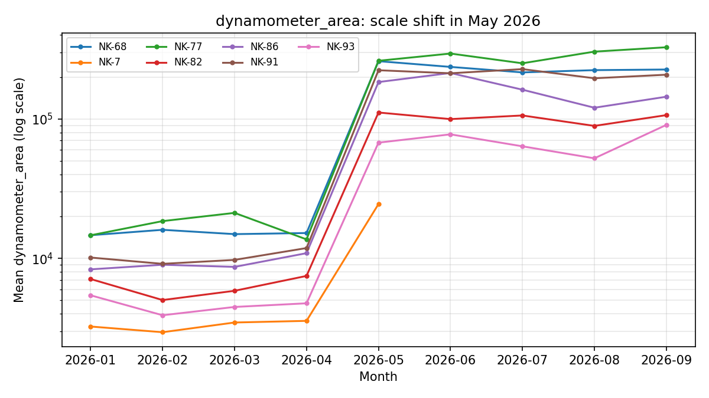
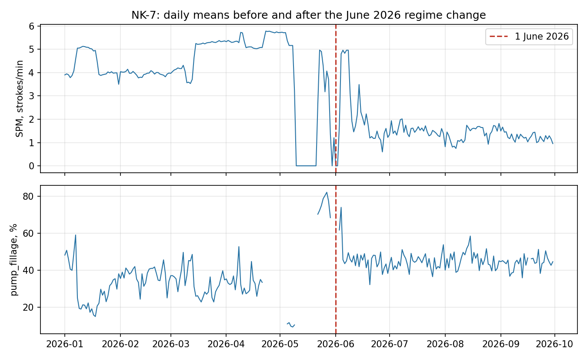
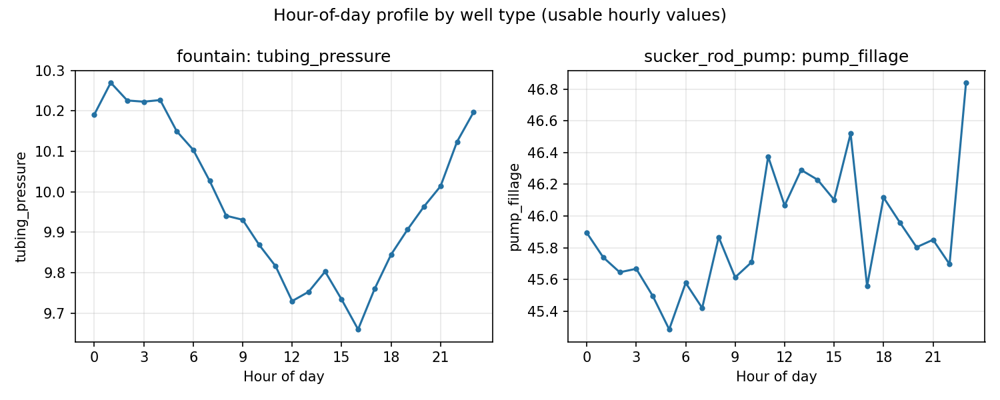
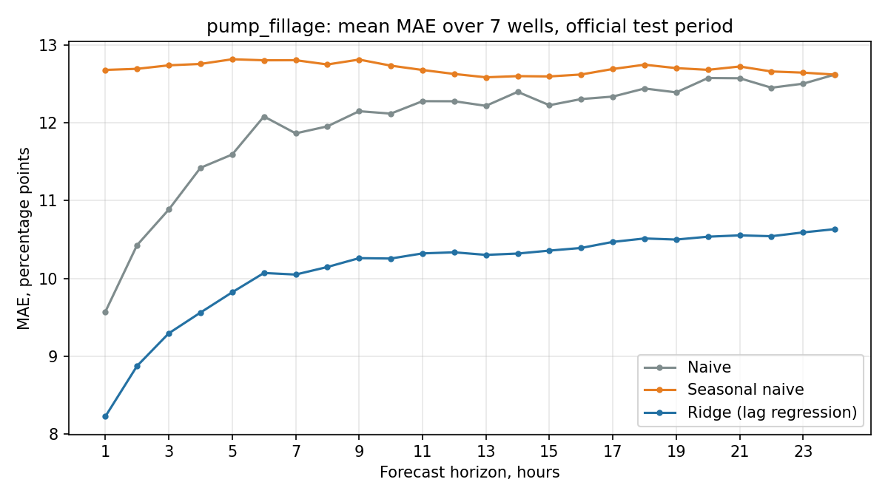
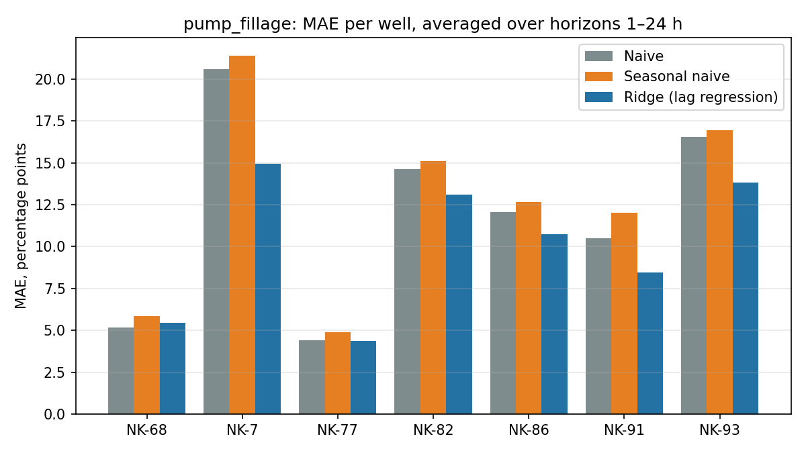
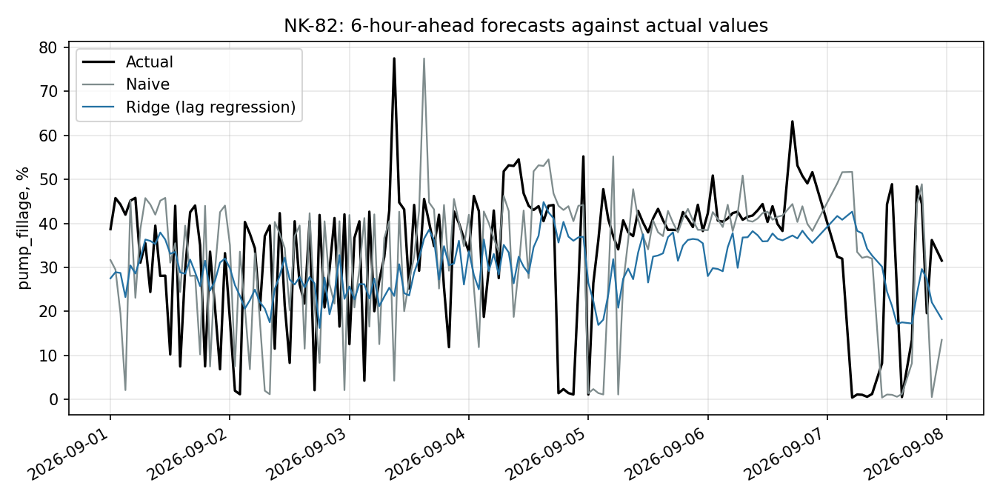

# Short-Term Forecasting of Well Parameters

Project report. Cluster 4: Industrial Sensor Data Analytics (NK Oil Wells).

Repository: https://github.com/R0onen/Short-Term-Forecasting-of-Well-Parameters

## 1. Goal

Forecast pump fillage of sucker-rod-pump oil wells 1 to 24 hours ahead from hourly sensor data, and compare a lag regression with two baselines on the chronological train/test split published with the dataset. Around the forecast the project builds a reproducible data pipeline, a data quality audit, an exploratory analysis of both well types and an interactive dashboard.

## 2. Data

Source: NK Oil Well Sensor Monitoring v2 on Hugging Face, pinned to revision `4004bb78ca8811a87c2892a89e457c59d22ace2b`. The pipeline downloads `train.csv` and `test.csv` and verifies their SHA-256 hashes, header, row counts and time boundaries on every run.

| Property | Value |
| --- | --- |
| Rows (long format) | 258,387 hourly means (train 206,706, test 51,681) |
| Wells | 10: 3 fountain, 7 sucker rod pump |
| Sensors | 8; 43 applicable well–sensor pairs |
| Train period | 2026-01-01 00:00 to 2026-08-08 22:00 |
| Test period | 2026-08-08 23:00 to 2026-09-30 23:00 |
| Columns | `well_id, well_type, timestamp, parameter, value, unit, n_obs, flag` |

Fountain wells report tubing, line and casing pressure (atm). Pump wells report strokes per minute (SPM), pump fillage (%), minimum and maximum rod weight (kg) and dynamometer card area.

The dataset is below the recommended 500K rows, so memory is not a practical limit here. The loading approaches required for larger data are still implemented and measured in section 5.

## 3. Pipeline and database

### 3.1 Long to wide

The published data is in long format: one row per well, hour and sensor. `wells.data.pipeline` validates each row, then pivots usable values to a wide table with one row per well-hour and one column per sensor. The wide table is reindexed to the full calendar of 10 wells × 6,552 hours = 65,520 rows, so a missing hour is an explicit row with NULL values and not an absent row.

### 3.2 SQLite schema

The database has nine tables; the ER diagram is in [docs/ER.md](docs/ER.md).

| Table | Content |
| --- | --- |
| `dataset_meta` | Revision, hashes and split boundaries |
| `series_catalog` | Which sensor applies to which well, with unit |
| `measurements_raw` | Every published CSV row as text, with source file and row number |
| `measurements_long` | Validated fact table with flag and usability mask |
| `measurements_wide` | Pivot on the full hourly calendar |
| `quality_issues` | Audit journal: masked records and annotated periods |
| `backtest_predictions`, `metrics`, `forecast_path` | Forecast results |

Primary and foreign keys and CHECK constraints are enforced. The build writes a temporary database, validates it and only then replaces the working file.

### 3.3 SQL queries

`wells.analysis.sql_report` runs 12 analytical queries, loads each result into Pandas and saves it as CSV. The SQL text and results are in [reports/sql_queries.md](reports/sql_queries.md). The pipeline additionally ships `gaps.sql` and `aggregates.sql`, which the dashboard uses.

| Query | SQL features | Used for |
| --- | --- | --- |
| 01 split boundaries | GROUP BY | Confirms the chronological split |
| 02 coverage by type | LEFT JOIN, GROUP BY | EDA by well type |
| 03 flagged series | GROUP BY, HAVING | Quality audit |
| 04 longest gaps | CTE, window `LAG` | Gap search |
| 05 area scale shift | CTE, window `LAG` | May 2026 scale shift |
| 06 NK-7 regime | CASE, GROUP BY | June 2026 regime change |
| 07 low fillage hours | JOIN with aggregated subquery | EDA |
| 08 daily profile | JOIN, GROUP BY | Hour-of-day pattern |
| 09 quality issues | LEFT JOIN, GROUP BY | Audit summary |
| 10 model wins | CTE, window `RANK` | Method comparison |
| 11 MAE per well | JOIN, conditional aggregation | Method comparison |
| 12 MAE by horizon | GROUP BY | Method comparison |

## 4. Data quality audit

Every rejected or masked record has a row in `quality_issues` with a reason code. A flagged value is kept in `measurements_long` with `is_usable = 0` and becomes NULL in the wide table; nothing is deleted or interpolated.

| Issue | Records | Wells | Handling |
| --- | ---: | ---: | --- |
| `weight_overflow` (published flag) | 4,098 | 4 | Masked |
| `area_negative` (published flag) | 2,921 | 6 | Masked |
| `area_extreme` (published flag) | 97 | 3 | Masked |
| `spm_outlier` (published flag) | 2 | 2 | Masked |
| Reversed rod load (min above max) | 26 (13 pairs) | 2 | Both sides masked |
| `area_scale_shift` | 8 annotations | 7 | Annotated, values kept |
| `nk7_regime_change` | 3 annotations | 1 | Annotated, used as a training boundary |

**Missing hours.** The longest outage is NK-86 with 313 consecutive missing hours (29 April to 12 May 2026), followed by NK-91 with 216 and 157 hours. All wells share a gap of about 20 hours on 15–16 April. NK-75 has no line pressure observations at all in the test period, although the sensor applies to it.

**Flags.** Flags are concentrated in NK-7: 50% of its dynamometer area values and 40% of its maximum rod weight values are flagged. The target `pump_fillage` has no published flags.

**Dynamometer area scale shift.** In May 2026 the monthly mean of `dynamometer_area` rises by a factor of 17 to 19 on NK-68 and NK-77 and stays at the new level (figure below). The cause is not documented, so the values are kept and annotated, no unit correction is applied, and the area is not used as a model input.

**NK-7 regime change.** From June 2026 the mean SPM of NK-7 falls from 4.17 to 1.56 strokes/min while mean pump fillage rises from 35.1% to 45.1%. For NK-7 the model is therefore trained only on data from 1 June 2026.

## 5. Handling data volume: measurements

`wells.analysis.benchmark` measures time and memory of each approach on the full 258,387 rows. One run on the development machine:

| Approach | Read time, s | In-memory size, MB | File size, MB |
| --- | ---: | ---: | ---: |
| CSV, default dtypes | 0.16 | 85.8 | 18.9 |
| CSV, `category` and `int16` dtypes | 1.06 | 5.7 | 18.9 |
| CSV, `chunksize=50000` aggregation | 0.15 | peak 4.5 | 18.9 |
| Parquet (pyarrow), optimized dtypes | 0.04 | 5.7 | 1.8 |

- Declaring the five repeated text columns as `category` cuts memory by 15 times (85.8 to 5.7 MB).
- Reading in chunks keeps peak memory at 4.5 MB for an aggregation, independent of file size.
- Parquet is 10 times smaller on disk and about 4 times faster to read than the default CSV read.

**Pandas versus SQL** on the same tasks:

| Task | Pandas | SQL |
| --- | --- | --- |
| Long to wide pivot | 0.08 s, peak 23 MB | 0.46 s, peak 34 MB |
| Daily mean per series | 0.15 s, peak 42 MB | 0.56 s, peak 3 MB |

Pandas is faster when the data is already in memory. SQL aggregation returns only the small result and uses far less memory, which is why the dashboard reads aggregates through SQL, while the pivot is done once in Pandas during the build.

## 6. Exploratory analysis

Descriptive statistics of usable hourly values:

| Well type | Sensor | Count | Mean | Std | Median |
| --- | --- | ---: | ---: | ---: | ---: |
| Fountain | tubing_pressure, atm | 19,093 | 9.98 | 5.62 | 9.50 |
| Fountain | line_pressure, atm | 14,209 | 4.04 | 2.19 | 4.43 |
| Fountain | casing_pressure, atm | 11,682 | 17.28 | 8.10 | 21.10 |
| Pump | SPM, strokes/min | 43,934 | 5.10 | 1.82 | 5.37 |
| Pump | pump_fillage, % | 40,652 | 45.89 | 29.95 | 47.08 |
| Pump | max_rod_weight, kg | 41,344 | 9,761 | 2,295 | 9,948 |
| Pump | min_rod_weight, kg | 42,710 | 7,637 | 2,731 | 7,539 |

- **Pump fillage differs strongly between wells.** Mean fillage ranges from about 20% (NK-93, NK-82, NK-86) to 81% (NK-91). The low-fillage wells spend 31–35% of their hours below half of their own average, so their series are much more volatile.
- **Correlations (Spearman, hours where both sensors are present).** In fountain well NK-83 the three pressures move together (0.48 to 0.68). In pump well NK-68 fillage is negatively related to maximum rod weight (−0.49) and dynamometer area (−0.43), and only weakly to SPM (−0.26).
- **Daily pattern.** The hour-of-day profile of both main sensors is weak (figure below). This matches the forecast result: the seasonal baseline that repeats the value from 24 hours earlier is the weakest method.

The dashboard shows the same analysis interactively for any well, sensor and period: history with gaps and flags, hour-of-day profile with quartiles, correlation matrix, coverage heatmap and forecasts.

## 7. Forecasting methods

Target: `pump_fillage` (%) of the seven pump wells, horizons 1 to 24 hours. A forecast is issued at origin hour `t` for target hour `t + h`.

| Method | Forecast for `t + h` |
| --- | --- |
| Naive (baseline) | Last known value `y[t]` |
| Seasonal naive (baseline) | Value 24 hours before the target, `y[t + h − 24]` |
| Ridge lag regression | Linear model on lags `y[t], y[t−1], y[t−2], y[t−3], y[t−6], y[t−12], y[t−24]` and sine/cosine of the target hour, standardized, one model per well and horizon, predictions clipped to 0–100% |

**Leakage-free protocol.**

- The published chronological split is used as is, with no shuffling.
- All features use only hours at or before the origin. Missing hours stay missing: there is no interpolation.
- The regularization strength is chosen from 0.1, 1.0 and 10.0 on a validation part inside train (from 15 July 2026). The selected value is 10.0; the three candidates differ only in the third decimal of validation MAE.
- Models are then refitted on all training rows whose target hour is before the test start and stay fixed during the test.
- The three methods are scored on the same set of points: a point counts only if the actual value and all three predictions exist. Coverage reports what share of test hours this is (82–92% per well).
- Automated tests check that changing test values does not change the selected alpha, scaler or coefficients.

## 8. Results

Mean MAE over the seven wells on the official test period, in percentage points:

| Horizon | Naive | Seasonal naive | Ridge |
| ---: | ---: | ---: | ---: |
| 1 h | 9.57 | 12.68 | **8.22** |
| 3 h | 10.88 | 12.74 | **9.29** |
| 6 h | 12.08 | 12.81 | **10.07** |
| 12 h | 12.28 | 12.63 | **10.33** |
| 18 h | 12.44 | 12.75 | **10.51** |
| 24 h | 12.62 | 12.62 | **10.63** |

MAE per well, averaged over the 24 horizons:

| Well | Naive | Seasonal naive | Ridge | Coverage |
| --- | ---: | ---: | ---: | ---: |
| NK-77 | 4.43 | 4.90 | **4.37** | 0.88 |
| NK-68 | **5.16** | 5.85 | 5.43 | 0.92 |
| NK-91 | 10.48 | 12.04 | **8.44** | 0.82 |
| NK-86 | 12.05 | 12.67 | **10.72** | 0.91 |
| NK-82 | 14.63 | 15.10 | **13.12** | 0.82 |
| NK-93 | 16.55 | 16.94 | **13.83** | 0.85 |
| NK-7 | 20.60 | 21.41 | **14.94** | 0.84 |

Cost of each method over all 168 well–horizon groups:

| Method | Fit time, s | Prediction time, s | Peak memory, MB | Mean MAE |
| --- | ---: | ---: | ---: | ---: |
| Naive | 0 | 0.01 | 2.0 | 11.99 |
| Seasonal naive | 0 | 0.01 | 2.0 | 12.70 |
| Ridge | 1.33 | 0.84 | 2.8 | **10.12** |

**Interpretation.**

- Ridge has the lowest MAE in 143 of the 168 well–horizon groups, naive in 25 and seasonal naive in 2 (ties at 24 hours are counted for both baselines).
- Ridge improves on naive by 14% at 1 hour and by 16% at 24 hours on average. The gain is largest on volatile wells (NK-7: 20.6 to 14.9) and absent on stable ones: on NK-68 naive is slightly better.
- Error grows quickly over the first six hours and then flattens, so most of the predictable signal is in the most recent hours.
- The two baselines are identical at 24 hours by construction, because both read the value at the origin.
- Ridge costs about two seconds for all 168 models and under 3 MB of memory, so its accuracy gain comes at a negligible price. It is the recommended method, with naive as an acceptable fallback for stable wells.

## 9. Dashboard

`streamlit run app.py -- --db data/processed/wells.sqlite` opens a local read-only dashboard with filters for well type, well, sensor and period. It has five interactive Plotly figures: history with trend, gaps and flags; hour-of-day profile; correlation matrix; coverage heatmap; and forecast against actual values with MAE by horizon. The forecast section switches between the backtest and the latest 24-hour release and lets the user choose the horizon and the methods.

## 10. Reproducibility and testing

The project runs from the README: install `requirements.txt`, build the database, run the forecast, start the dashboard. The automated suite has 53 tests on a synthetic fixture (data pipeline, SQL, forecast boundaries and leakage, dashboard states, analysis scripts) plus an optional end-to-end check on the official data that runs the whole chain twice and compares the results.

## 11. Limitations

- The dataset has 258K rows, below the recommended 500K, so the volume techniques are demonstrated and measured but not strictly needed.
- The source does not state a time zone or the delay with which hourly means become available; the project assumes a value is known when its hour closes.
- MAE is computed only on hours where all inputs exist. On wells with many gaps the result describes 82–85% of the test hours.
- Ridge is linear and uses only the target's own history. Other sensors and non-linear models were left out of scope.
- NK-7 is trained on about ten weeks of data after its regime change, and it remains the hardest well.
- The cause of the dynamometer area scale shift is unknown, so that sensor is annotated and not corrected.

## 12. Conclusions

- A validated, reproducible SQLite database was built from the published long-format data, with a full audit journal of flags, gaps and the two known dataset problems.
- Pump fillage behaves very differently across wells, and its daily pattern is weak.
- A simple lag regression beats both baselines on six of seven wells and at every horizon on average, reducing MAE from 11.99 (naive) to 10.12 percentage points, at a negligible computing cost.
- Where a well is stable, the naive forecast is equally good, which the report states rather than hides.

## References

1. Tleubayeva A. NK Oil Well Sensor Monitoring v2. Hugging Face dataset. https://huggingface.co/datasets/Arailym-tleubayeva/NK-Oil-Well-Sensor-Monitoring-v2
2. Hyndman R. J., Athanasopoulos G. Forecasting: Principles and Practice, 3rd ed. OTexts, 2021. https://otexts.com/fpp3/
3. Pedregosa F. et al. Scikit-learn: Machine Learning in Python. Journal of Machine Learning Research 12, 2011.
4. McKinney W. Data Structures for Statistical Computing in Python. Proceedings of the 9th Python in Science Conference, 2010.
5. SQLite documentation: window functions. https://www.sqlite.org/windowfunctions.html
6. Streamlit documentation. https://docs.streamlit.io
