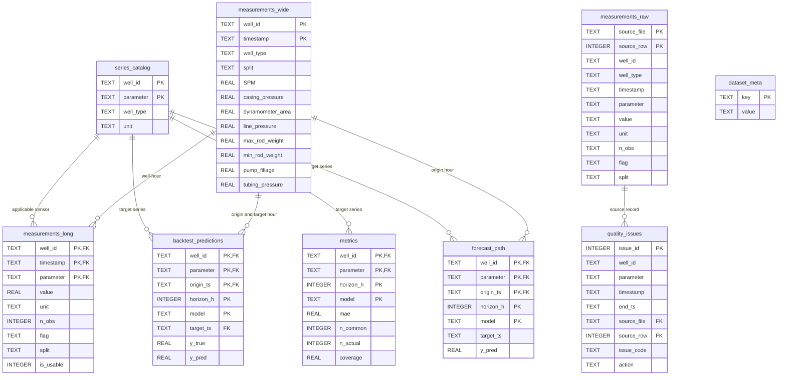

# ER diagram

SQLite schema defined in [`wells/data/sql/schema.sql`](../wells/data/sql/schema.sql). GitHub renders the diagram below.

## Notes on the design

- `measurements_raw` keeps every published CSV row as text, so a rejected or masked value can always be traced to its source record.
- `measurements_long` is the normalized fact table: one row per well, hour and sensor, with unit, flag and usability mask.
- `measurements_wide` is the pivot: one row per well-hour on the full calendar (10 wells × 6,552 hours), with unusable, absent and inapplicable values as NULL. It is derived from `measurements_long` and kept for lag features and sensor comparison.
- `series_catalog` records which sensors apply to which well, so a missing series can be told apart from an inapplicable one.
- `dataset_meta` is a key–value table with the dataset revision, file hashes and the published train/test boundaries.
- The three forecast tables are written only by `wells.forecast.run`.
